  

<h3 align="center"><code>org@github ~ $ whoami</code></h3>

  

 

<h3 align="center"><code>org@github ~ $ ./projects.sh</code></h3>

<!-- PROJECTS:START -->

#### Data Engineering

- **[APACHE_AIRFLOW_WORKS](https://github.com/ACADEMIC-AND-PERSONAL-PROJECTS/APACHE_AIRFLOW_WORKS)** — NYC Taxi Data Pipeline built with Apache Airflow for the DataTalksClub Data Engineering Zoomcamp. Adapted from Kestra + GCP to Airflow + Oracle Cloud (Object Storage + ADW). Full ELT: extract 40M+ NYC taxi rows, …

#### AI Engineering & Agents

- **[NeuralPulse](https://github.com/ACADEMIC-AND-PERSONAL-PROJECTS/NeuralPulse)** — Pipeline automatisé de digest d'actualités IA. Scrape 12 sources majeures (OpenAI, Anthropic, DeepMind, Mistral...) chaque samedi, déduplique, résume via Groq LLM (qwen3.8-27b) avec un commentaire pédagogique en …
- **[langchain4j-quickstart](https://github.com/ACADEMIC-AND-PERSONAL-PROJECTS/langchain4j-quickstart)** — Chatbot terminal en Java avec LangChain4j et Moonshot AI (Kimi K3). Premier projet du cours LangChain4j — Du zero au hero. Apprends a integrer un LLM dans une application Java.
- **[Customer-Support-Agent](https://github.com/ACADEMIC-AND-PERSONAL-PROJECTS/Customer-Support-Agent)** — Projet d’apprentissage réalisé avec Cognitive Class : création d’un agent de support client avec PydanticAI et Pydantic. Le projet explore les agents IA, la validation des sorties structurées, les prompts few-shot, …
- **[AI-DEV-TOOLS-ZOOMCAMP-HOMEWORK_1](https://github.com/ACADEMIC-AND-PERSONAL-PROJECTS/AI-DEV-TOOLS-ZOOMCAMP-HOMEWORK_1)** — `Python`

#### Machine Learning & AI

- **[Homework-3-Machine-Learning-for-Classification](https://github.com/ACADEMIC-AND-PERSONAL-PROJECTS/Homework-3-Machine-Learning-for-Classification)** — `Jupyter Notebook`
- **[Google-DeepMind-AI-Research-Foundations-solutions](https://github.com/ACADEMIC-AND-PERSONAL-PROJECTS/Google-DeepMind-AI-Research-Foundations-solutions)** — Coursework, lab solutions, and research notes from the full Google DeepMind AI Research Foundations learning path.
- **[California-Housing-Prices](https://github.com/ACADEMIC-AND-PERSONAL-PROJECTS/California-Housing-Prices)** — `Jupyter Notebook`
- **[Homework-2-Machine-Learning-for-Regression](https://github.com/ACADEMIC-AND-PERSONAL-PROJECTS/Homework-2-Machine-Learning-for-Regression)** — Homework 2 of the Machine Learning Zoomcamp 2026 (DataTalks Club). Build a linear regression model to predict car fuel efficiency (MPG). Covers missing value imputation, Ridge regularization, seed sensitivity …
- **[Homework-1-Introduction-to-Machine-Learning](https://github.com/ACADEMIC-AND-PERSONAL-PROJECTS/Homework-1-Introduction-to-Machine-Learning)** — First homework for Machine Learning Zoomcamp 2026 (DataTalks Club). Explores Pandas & NumPy fundamentals: data exploration, missing value imputation, and linear algebra with a vehicle fuel efficiency dataset (10K …
- **[MIT_WEEK7_Neural_Network_II](https://github.com/ACADEMIC-AND-PERSONAL-PROJECTS/MIT_WEEK7_Neural_Network_II)** — Solutions and notes for Week 7 (Neural Networks II) of MITx 6.036, including the homework notebook, Python implementations of Linear, Tanh, ReLU and SoftMax layers, NLL loss, SGD training routines, reproducible …
- **[MIT_WEEK6_Neural_Network_I](https://github.com/ACADEMIC-AND-PERSONAL-PROJECTS/MIT_WEEK6_Neural_Network_I)** — Solutions and notes for Week 6 (Neural Networks I) of MITx 6.036, including the homework notebook, Python implementations, understanding concepts behind Neural Networks.
- **[MIT_WEEK5_Regression](https://github.com/ACADEMIC-AND-PERSONAL-PROJECTS/MIT_WEEK5_Regression)** — `Jupyter Notebook`
- **[MIT_WEEK4_Margin_Maximization](https://github.com/ACADEMIC-AND-PERSONAL-PROJECTS/MIT_WEEK4_Margin_Maximization)** — `Jupyter Notebook`
- **[EDA-WITH-PYTHON](https://github.com/ACADEMIC-AND-PERSONAL-PROJECTS/EDA-WITH-PYTHON)** — `Jupyter Notebook`

#### Full-Stack & Apps

- **[Aether-Archive](https://github.com/ACADEMIC-AND-PERSONAL-PROJECTS/Aether-Archive)** — A local-first, mobile-first digital sanctuary for aesthetic photos and monthly 6-picture dumps. Spring Boot + React + SQLite, Dark Glassmorphism, zero external requests.
- **[TECHBLOCKS](https://github.com/ACADEMIC-AND-PERSONAL-PROJECTS/TECHBLOCKS)** — Documentation collaborative orientée développeurs — éditeur de blocs (Markdown, Code, Mermaid, API, Callout), autosave, historique de révisions, JWT. React 19 · Spring Boot 3.5 · PostgreSQL 16. 100% vibe coded — …
- **[IPDL_v2](https://github.com/ACADEMIC-AND-PERSONAL-PROJECTS/IPDL_v2)** — Projet de classe initialement réalisé en groupe en classe avec des codes donnes par le prof avec GitLab comme dépôt distant, SénSanté Pro est repris de ma propre initiative et développé individuellement sur GitHub …
- **[TRACE](https://github.com/ACADEMIC-AND-PERSONAL-PROJECTS/TRACE)** — `JavaScript`
- **[LeagueScore](https://github.com/ACADEMIC-AND-PERSONAL-PROJECTS/LeagueScore)** — Football live-score app vibe-coded for the AI Dev Tools Zoomcamp 2026. Full-stack with React 19, TypeScript, FastAPI, and SQLAlchemy. Includes live scores, match center, league standings, admin console, and …

#### Learning & Foundations

- **[SCALA-BANK](https://github.com/ACADEMIC-AND-PERSONAL-PROJECTS/SCALA-BANK)** — A learning project. I'm building a command-line banking system in Scala 3 to actually apply what I learn in class — case classes, pattern matching, Either, enums, for comprehensions. Everything is immutable, …

<!-- PROJECTS:END -->

 

<h3 align="center"><code>org@github ~ $ ./stack.sh</code></h3>

  

 

<h3 align="center"><code>org@github ~ $ ./links.sh</code></h3>

  
  
  
  

  <a href="mailto:khadimmbaye@esp.sn"><code>khadimmbaye@esp.sn</code></a>

